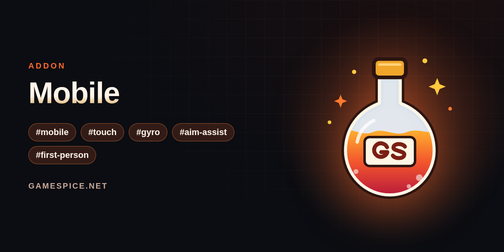

[](https://moddingcommunity.com/a/128-gs-mobile)

Touch controls for first-person Godot 4 games: a drawn virtual stick, drag-to-look, game-declared buttons, optional gyro look on the web, and server-controlled aim assist and auto-fire.

- Drives GameSpice Player Controller's `GSFpsTouchSampler`; the game keeps its own input pipeline.
- Code only: drawn with `_draw` and GameSpice UI's theme colours, no textures.
- Every option is bounded by replicated server cvars (`sv_mobile_*`, `sv_aim_assist*`, `sv_autofire*`).
- Aim assist and auto-fire act on look input and the fire button before the command, so simulation, hit registration and lag compensation are untouched.

gs-mobile is a [GameSpice](https://gamespice.net) addon under the MIT licence, built with Claude Code. `examples/mobile_selftest.tscn` runs headless. The games in [Zee's Games](https://zeesgames.com) are built on the GameSpice addons and run on live servers, including in phone browsers.

## Install

Copy `addons/gs_mobile/` into your project next to `gs_core`, `gs_ui` and `gs_player_controller`, and enable the plugin.

## Use

```gdscript
var controls := GSMobileControls.new()
controls.setup(sampler, [{"id": &"fire", "label": "FIRE", "offset": Vector2(86, 150), "radius": 52.0}])
controls.crosshair_fn = my_crosshair_kind
hud.add_child(controls)
```

See [docs/design.md](docs/design.md) for forwarding, the cvars and the rest.

## Test

Run `examples/mobile_selftest.tscn` headless.

## Used by

### Zee's Games

Zee's Games is a collection of games I made on GameSpice, for demonstration and for fun. They show what the platform can do, and they run on live servers you can join. Anybody can create games on GameSpice, and each addon is its own repository and can be used separately from the games and from the rest of GameSpice.

The following games carry it in their addons folder:

- [Fatal Contact](https://zeesgames.com/fatal-contact)
- [Airdrift](https://zeesgames.com/airdrift)
- [Playlot](https://zeesgames.com/playlot)
- [Buses From Hell](https://zeesgames.com/buses-from-hell)
- [Smash Copter](https://zeesgames.com/smash-copter)
- [Zombie Zone](https://zeesgames.com/zombie-zone)
- [Hide n Seek](https://zeesgames.com/hide-n-seek)
- [Prop Hunt](https://zeesgames.com/prop-hunt)
- [Murder Mystery](https://zeesgames.com/murder-mystery)
- [Deathrun](https://zeesgames.com/deathrun)
- [Wipeout](https://zeesgames.com/wipeout)
- [Look At Me](https://zeesgames.com/look-at-me)

The whole collection is at [zeesgames.com](https://zeesgames.com).

## License

MIT
